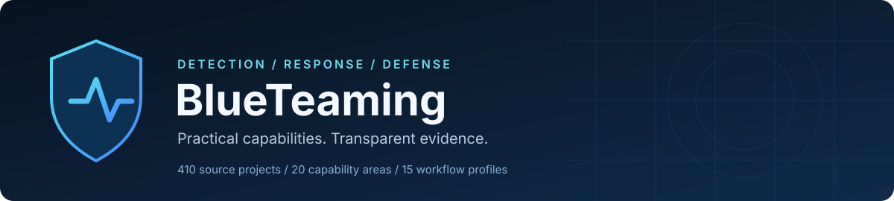

# BlueTeaming

[](https://github.com/bunnyho1e/BlueTeaming/actions/workflows/validate.yml)

**See clearly. Investigate precisely. Defend with evidence.**

A curated workspace of defensive security tools, platforms, libraries, detection content and integrations from canonical GitHub and GitLab sources.

**410 active source projects · 407 GitHub · 3 GitLab · 20 categories · 15 workflow profiles**

Initial source screen: **2026-10-21**. Every active entry has an exact commit pin, dated review evidence, an inspection scope and a usage class. Counts refer to distinct source projects, not installed products or command aliases.

[Browse the catalog](CATALOG.md) · [Choose a workflow](WORKFLOWS.md) · [Review evidence and limits](SOURCE_REVIEW.md) · [Excluded candidates](EXCLUDED.md)

## Start with the sources

Requirements: Git and Python 3.9 or newer. The helper has no third-party Python dependencies.

```bash
git clone https://github.com/bunnyho1e/BlueTeaming.git
cd BlueTeaming
python3 fetch_sources.py --profile starter --dry-run
python3 fetch_sources.py --profile starter --jobs 4
```

A normal clone retrieves this catalog and its helpers. The next step fetches upstream source into `tools/<category>/<host>/<project>/` at the recorded commits. It does not install packages, execute tools, build containers, initialize nested submodules or retrieve Git LFS payloads. Build and deployment instructions remain with each upstream project.

```bash
python3 fetch_sources.py --profile incident-response --dry-run
python3 fetch_sources.py --profile detection --jobs 4
python3 fetch_sources.py --category network-defense --dry-run
python3 fetch_sources.py --repo github:SigmaHQ/sigma --dry-run
python3 fetch_sources.py --all --dry-run
```

`--all` includes specialized analysis and lab source projects. Select a workflow or individual source before retrieving the complete collection. No deployment, agent registration or target-facing operation is performed by the helper.

## Workflow profiles

| Profile | Sources | Intended use |
| --- | ---: | --- |
| `starter` | 11 | A compact first selection for detection, triage and source exploration. |
| `soc` | 87 | Security platforms, endpoint visibility, detection content and telemetry. |
| `incident-response` | 53 | Evidence collection, timelines and investigation support. |
| `dfir` | 84 | Windows, memory, disk, mobile and macOS artifact analysis. |
| `detection` | 25 | Sigma, analytics, event-log triage and ATT&CK content. |
| `network` | 29 | Network telemetry, IDS, packet analysis and deception. |
| `threat-intelligence` | 21 | Enrichment, sharing, indicator management and intelligence. |
| `cloud` | 21 | Cloud posture, identity investigation and cloud incident response. |
| `containers` | 31 | Kubernetes, runtime monitoring, policy and image assessment. |
| `hardening` | 31 | Host auditing, compliance content and defensive configuration. |
| `supply-chain` | 57 | Secrets, source analysis, SBOMs and artifact verification. |
| `identity` | 15 | Identity posture, access control, certificates and secrets. |
| `email` | 9 | Mail filtering, DMARC and phishing investigation. |
| `malware-lab` | 33 | Malware triage and reverse engineering; use an isolated lab. |
| `validation-lab` | 10 | Adversary simulation and test content; use an isolated lab. |

## Capability map

| Area | Sources |
| --- | ---: |
| [Security Platforms](CATALOG.md#security-platforms) | 16 |
| [Endpoint and Runtime](CATALOG.md#endpoint-and-runtime) | 19 |
| [Network Defense](CATALOG.md#network-defense) | 18 |
| [Detection Engineering](CATALOG.md#detection-engineering) | 25 |
| [Incident Response](CATALOG.md#incident-response) | 26 |
| [Windows Forensics](CATALOG.md#windows-forensics) | 21 |
| [Memory Forensics](CATALOG.md#memory-forensics) | 6 |
| [Disk and Artifact Forensics](CATALOG.md#disk-and-artifact-forensics) | 31 |
| [Malware Analysis](CATALOG.md#malware-analysis) | 33 |
| [Threat Intelligence](CATALOG.md#threat-intelligence) | 21 |
| [Cloud Security](CATALOG.md#cloud-security) | 21 |
| [Container and Kubernetes](CATALOG.md#container-and-kubernetes) | 31 |
| [Vulnerability Management](CATALOG.md#vulnerability-management) | 33 |
| [Application and Supply Chain](CATALOG.md#application-and-supply-chain) | 24 |
| [Hardening and Compliance](CATALOG.md#hardening-and-compliance) | 31 |
| [Identity and Secrets](CATALOG.md#identity-and-secrets) | 15 |
| [Email and Phishing Defense](CATALOG.md#email-and-phishing-defense) | 9 |
| [Deception and Honeypots](CATALOG.md#deception-and-honeypots) | 11 |
| [Security Data and Telemetry](CATALOG.md#security-data-and-telemetry) | 9 |
| [Defensive Validation and Labs](CATALOG.md#defensive-validation-and-labs) | 10 |

## What the screen establishes

The selection checks canonical provider identities, archive/fork/activity metadata, exact commits, bounded source text, selected build and entrypoint files, and known-advisory query results. Suspicious-pattern matches are retained with context. Detection rules often mention malicious behavior because detecting it is their purpose.

The active set contains **189 bounded snapshot screens** and **221 selected-file inspections**. Neither is a full code audit or a malware-free certificate. Dependencies, downloaded payloads, release binaries, container images, nested repositories and runtime behavior are outside this review.

Archived, stale, unresolved, insufficiently inspected and advisory-matching candidates remain outside every active download profile. An exclusion is a selection decision, not an accusation of malware. Provider stars are a discovery signal, never a security guarantee.

The helper validates the same allowlist for every selection. It rejects noncanonical URLs, invalid pins, path traversal, destination symlinks, external Git directories and unreviewed local Git settings. Hooks, filesystem monitors, inherited Git overrides and automatic submodule recursion are disabled for retrieval.

## Repository guide

| File | Purpose |
| --- | --- |
| [CATALOG.md](CATALOG.md) | Every active source, purpose, type, license, usage class and exact pin. |
| [WORKFLOWS.md](WORKFLOWS.md) | Practical selection paths for analysts and platform engineers. |
| [SOURCE_REVIEW.md](SOURCE_REVIEW.md) | Method, evidence scope and project-level review table. |
| [source-review.json](source-review.json) | Dated observations, fingerprints, indicators and advisory results. |
| [catalog.json](catalog.json) | Active source allowlist and workflow profiles. |
| [EXCLUDED.md](EXCLUDED.md) | Held candidates and the reasons. |
| [THIRD_PARTY.md](THIRD_PARTY.md) | Upstream ownership and license observations. |
| [SECURITY.md](SECURITY.md) | Reporting policy and operational review boundary. |
| [CONTRIBUTING.md](CONTRIBUTING.md) | Addition and pin-update requirements. |

[Validation record](VALIDATION.md) · [Automated validation](https://github.com/bunnyho1e/BlueTeaming/actions/workflows/validate.yml)

## Validate and maintain

```bash
python3 -m unittest -v
python3 render_catalog.py
python3 fetch_sources.py --all --dry-run
python3 review_sources.py --repo github:SigmaHQ/sigma
```

The review helper writes observations to `audit-output/`; it does not approve or update catalog pins automatically. Revisit upstream advisories before building or deploying a pinned development snapshot. See [CONTRIBUTING.md](CONTRIBUTING.md) for the review bar.

## License

Original catalog text and helper code: [MIT](LICENSE). Every upstream project retains its own license, ownership and trademarks. A catalog entry does not relicense upstream source or grant rights beyond its published terms.
